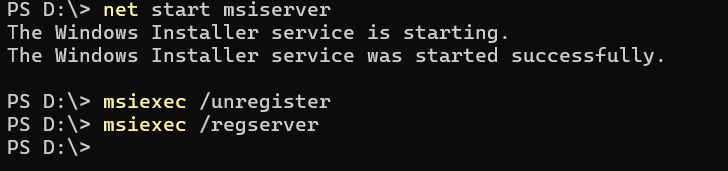
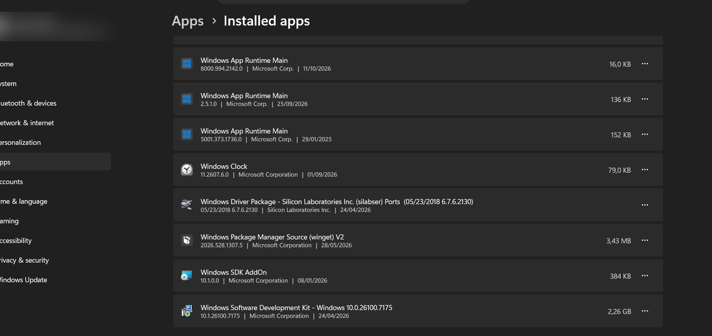
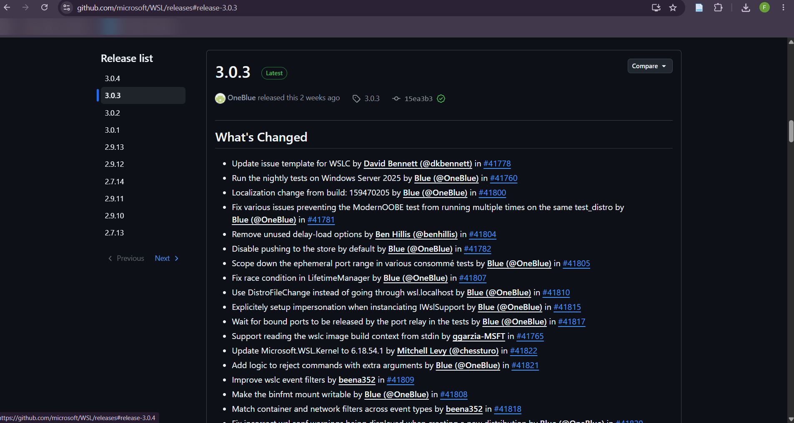
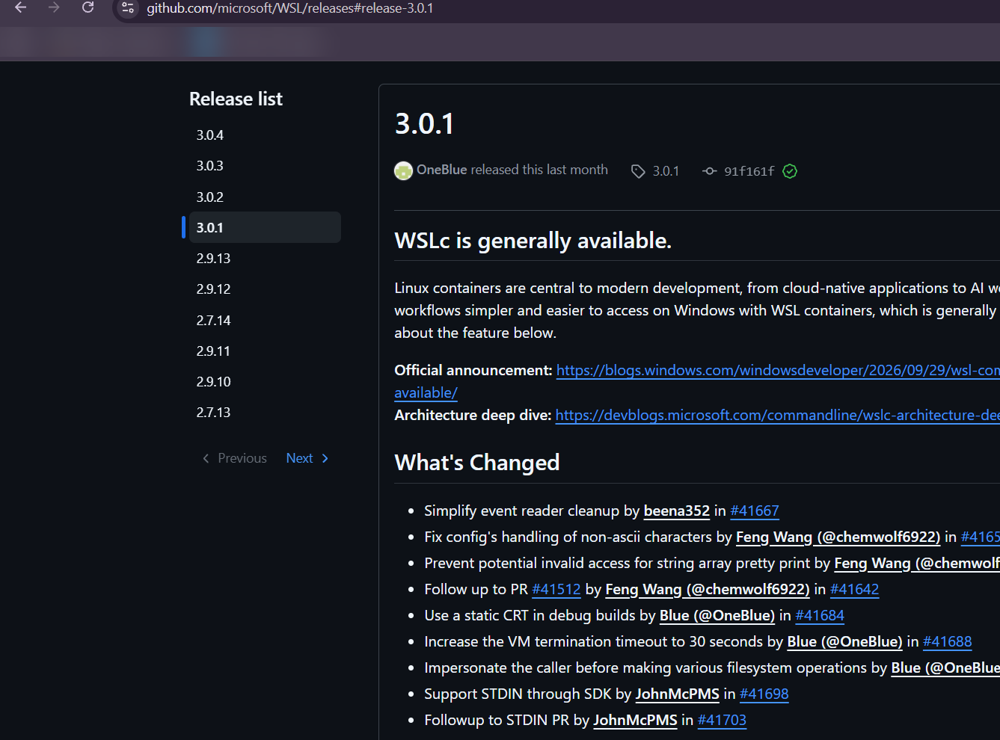
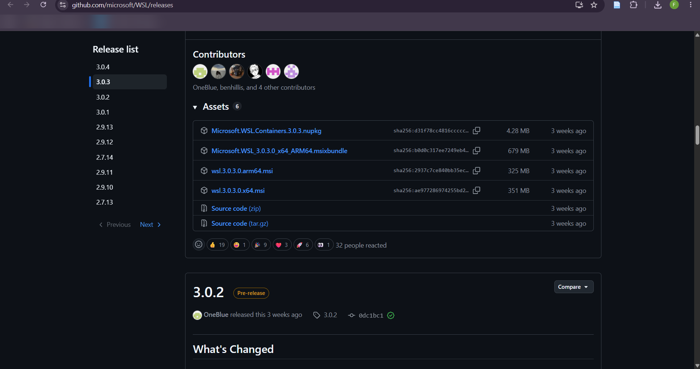
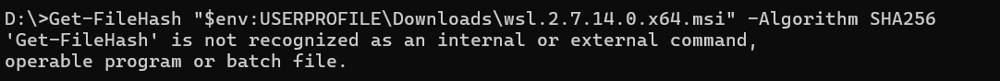
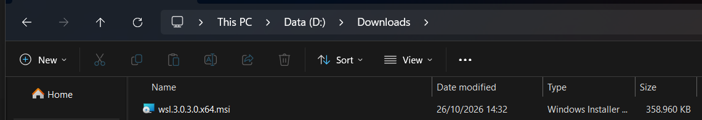
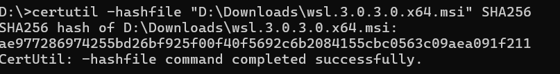
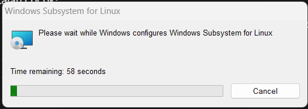
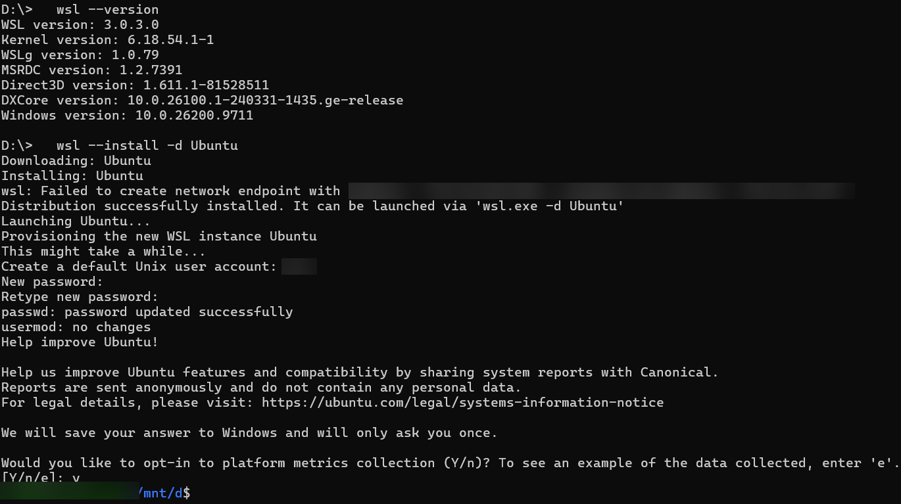

# Instalasi WSL di Windows 11 dan Perbaikan Error `REGDB_E_CLASSNOTREG`

Dokumentasi ini mencatat proses memasang Windows Subsystem for Linux (WSL) beserta Ubuntu di laptop Windows 11. Perintah `wsl --install` gagal dengan kode error `Wsl/CallMsi/Install/REGDB_E_CLASSNOTREG`. Masalah selesai setelah fitur Windows diaktifkan lewat DISM dan paket WSL dipasang ulang dari file MSI resmi Microsoft.

Setiap bagian memuat perintah yang dijalankan, keluaran yang muncul, dan alasan langkah itu diambil. Langkah yang tidak berhasil tetap dicatat supaya pembaca yang mengalami error yang sama tidak mengulang percobaan yang sama.

## Hasil akhir

| Komponen | Versi |
|---|---|
| Windows | 11, build 10.0.26200.9711 |
| WSL | 3.0.3.0 |
| Kernel Linux WSL | 6.18.54.1-1 |
| WSLg | 1.0.79 |
| Distribusi Linux | Ubuntu |

## Daftar isi

1. [Percobaan awal dengan `wsl --install`](#1-percobaan-awal-dengan-wsl---install)
2. [Registrasi ulang Windows Installer](#2-registrasi-ulang-windows-installer)
3. [Mengecek sisa aplikasi WSL](#3-mengecek-sisa-aplikasi-wsl)
4. [Mengaktifkan fitur Windows lewat DISM](#4-mengaktifkan-fitur-windows-lewat-dism)
5. [Memilih file installer di GitHub](#5-memilih-file-installer-di-github)
6. [Memeriksa keaslian file dengan hash SHA-256](#6-memeriksa-keaslian-file-dengan-hash-sha-256)
7. [Menjalankan installer MSI](#7-menjalankan-installer-msi)
8. [Verifikasi WSL dan instalasi Ubuntu](#8-verifikasi-wsl-dan-instalasi-ubuntu)
9. [Langkah lanjutan setelah instalasi](#9-langkah-lanjutan-setelah-instalasi)
10. [Masuk dan keluar dari WSL](#10-masuk-dan-keluar-dari-wsl)
11. [Ringkasan masalah dan solusi](#11-ringkasan-masalah-dan-solusi)
12. [Sumber rujukan](#12-sumber-rujukan)

Semua perintah dijalankan di Command Prompt (CMD) yang dibuka sebagai Administrator, kecuali disebutkan lain.

---

## 1. Percobaan awal dengan `wsl --install`

Microsoft menyarankan `wsl --install` sebagai cara pemasangan termudah. Perintah ini mengaktifkan fitur Windows yang dibutuhkan WSL dan memasang Ubuntu sebagai distribusi bawaan. Syaratnya Windows 10 versi 2004 (build 19041) ke atas atau Windows 11, dan terminal harus dibuka dengan hak Administrator [1].

```cmd
D:\>wsl --install
wsl: WSL installation appears to be corrupted (Error code: Wsl/CallMsi/Install/REGDB_E_CLASSNOTREG).
Press any key to repair WSL, or CTRL-C to cancel.
This prompt will time out in 60 seconds.
```

Pesan yang sama muncul di PowerShell biasa maupun di CMD Administrator. Hak akses ternyata tidak berpengaruh.

**Membaca kode error.** Kode itu tersusun dari beberapa bagian:

- `CallMsi/Install` menunjukkan kegagalan terjadi saat `wsl.exe` memanggil Windows Installer (layanan MSI) untuk memasang paket WSL.
- `REGDB_E_CLASSNOTREG` adalah kode error Windows yang berarti *class not registered*: komponen yang dipanggil tidak terdaftar di registry.

Windows menganggap WSL sudah ada tetapi rusak, lalu menawarkan perbaikan otomatis. Laporan pengguna lain di Microsoft Q&A dan di repositori WSL di GitHub menunjukkan error ini muncul juga di komputer yang belum pernah berhasil memasang WSL [3][4].

## 2. Registrasi ulang Windows Installer

Karena error terjadi di tahap pemanggilan Windows Installer, langkah pertama yang dicoba adalah menyalakan layanan Windows Installer (`msiserver`) dan mendaftarkannya ulang.

```cmd
net start msiserver
msiexec /unregister
msiexec /regserver
```



Layanan berhasil dinyalakan dan didaftarkan ulang tanpa pesan error. Namun `wsl --install` tetap menampilkan error yang sama. Artinya layanan Windows Installer bukan sumber masalah.

## 3. Mengecek sisa aplikasi WSL

Instalasi WSL lama yang rusak bisa menghalangi pemasangan baru. Pengecekan dilakukan di **Settings → Apps → Installed apps**. Rujukan Microsoft Q&A menyarankan menu *Repair* atau *Uninstall* pada aplikasi *Windows Subsystem for Linux* bila aplikasi itu ada di daftar [3].



Daftar diurutkan menurut abjad. Entri *Windows Subsystem for Linux* seharusnya muncul setelah *Windows Software Development Kit*, tetapi entri itu tidak ada. Tidak ada sisa aplikasi yang perlu dihapus, jadi proses lanjut ke langkah berikutnya.

> Bagian nama akun dan email di pojok kiri atas gambar sengaja diburamkan.

## 4. Mengaktifkan fitur Windows lewat DISM

`wsl --install` selalu berhenti di pengecekan paket yang rusak. Proses pemasangan kemudian dipecah menjadi langkah manual. Langkah pertama adalah mengaktifkan dua fitur Windows dengan DISM (Deployment Image Servicing and Management), sesuai panduan instalasi manual dari Microsoft [2]:

| Fitur | Fungsi |
|---|---|
| `Microsoft-Windows-Subsystem-Linux` | Fitur dasar WSL di Windows |
| `VirtualMachinePlatform` | Platform mesin virtual yang dipakai WSL 2 |

```cmd
D:\>dism.exe /online /enable-feature /featurename:Microsoft-Windows-Subsystem-Linux /all /norestart

Deployment Image Servicing and Management tool
Version: 10.0.26100.9549

Image Version: 10.0.26200.9711

Enabling feature(s)
[==========================100.0%==========================]
The operation completed successfully.

D:\>dism.exe /online /enable-feature /featurename:VirtualMachinePlatform /all /norestart

Deployment Image Servicing and Management tool
Version: 10.0.26100.9549

Image Version: 10.0.26200.9711

Enabling feature(s)
[==========================100.0%==========================]
The operation completed successfully.
```

Arti parameternya:

- `/online` menerapkan perubahan ke Windows yang sedang berjalan.
- `/all` ikut mengaktifkan fitur induk yang dibutuhkan.
- `/norestart` menunda restart supaya kedua perintah bisa dijalankan berurutan.

Microsoft menyebut restart wajib setelah `VirtualMachinePlatform` diaktifkan agar WSL 2 bisa dipakai [2]. Restart dilakukan setelah paket WSL terpasang (langkah 7). Prosesor juga harus mendukung virtualisasi (Intel VT-x atau AMD-V) dan fitur itu harus aktif di BIOS/UEFI.

## 5. Memilih file installer di GitHub

Paket WSL tersedia sebagai file MSI di halaman rilis repositori resmi Microsoft, `github.com/microsoft/WSL/releases`. Beberapa pengguna yang mendapat error `REGDB_E_CLASSNOTREG` melaporkan masalahnya selesai setelah memasang ulang WSL dari file MSI di halaman tersebut [3][5].

Halaman rilis berisi dua jenis rilis:

- **Pre-release** (label oranye): versi uji coba.
- **Latest** (label hijau): rilis stabil terbaru.

Status rilis dibaca dari label, bukan dari nomor versi. Saat dokumentasi ini dibuat, rilis berlabel **Latest** adalah **3.0.3**.



Rilis 3.0.1 menandai seri 3.0.x sebagai rilis umum (*generally available*) dan tidak memakai label *Pre-release*.



Bagian **Assets** pada rilis 3.0.3 berisi enam file. File yang dipakai untuk laptop dengan prosesor Intel atau AMD 64-bit adalah **`wsl.3.0.3.0.x64.msi`** (351 MB).



| File | Kegunaan |
|---|---|
| `wsl.3.0.3.0.x64.msi` | Installer untuk prosesor x64 (Intel/AMD). **File ini yang dipakai.** |
| `wsl.3.0.3.0.arm64.msi` | Installer untuk prosesor ARM, misalnya Snapdragon |
| `Microsoft.WSL_3.0.3.0_x64_ARM64.msixbundle` | Paket MSIX gabungan x64 dan ARM64 |
| `Microsoft.WSL.Containers.3.0.3.nupkg` | Paket NuGet untuk pengembang WSL Containers |
| Source code (zip / tar.gz) | Kode sumber WSL |

## 6. Memeriksa keaslian file dengan hash SHA-256

Setiap file di bagian Assets punya nilai hash SHA-256. Nilai hash dari file yang diunduh harus sama persis dengan nilai di GitHub. Kalau sama, file tidak berubah sejak diunggah Microsoft.

Percobaan pertama memakai `Get-FileHash`, tetapi perintah itu gagal:



`Get-FileHash` adalah cmdlet PowerShell, sedangkan perintah dijalankan di CMD. Cara membedakan keduanya ada di prompt: CMD menampilkan `D:\>`, PowerShell menampilkan `PS D:\>`. Di CMD, hash dihitung dengan `certutil`.

Folder Downloads di laptop ini berada di drive D, sehingga path file menjadi `D:\Downloads`:



```cmd
certutil -hashfile "D:\Downloads\wsl.3.0.3.0.x64.msi" SHA256
```



Hasil hash:

```
ae977286974255bd26bf925f00f40f5692c6b2084155cbc0563c09aea091f211
```

Awal hash (`ae977286974255bd2...`) sama dengan nilai `sha256:` yang tertera di halaman rilis. File aman untuk dipasang.

Untuk yang memakai PowerShell, perintah setaranya:

```powershell
Get-FileHash "D:\Downloads\wsl.3.0.3.0.x64.msi" -Algorithm SHA256
```

## 7. Menjalankan installer MSI

File `wsl.3.0.3.0.x64.msi` dijalankan dengan klik dua kali dari File Explorer, lalu jendela UAC disetujui dengan **Yes**.



Jendela installer berjalan sekitar satu menit dan tertutup sendiri setelah selesai. Tombol **Cancel** tidak boleh ditekan selama proses berlangsung.

Setelah installer selesai, komputer di-restart. Restart ini mengaktifkan fitur yang dinyalakan di langkah 4 [2].

## 8. Verifikasi WSL dan instalasi Ubuntu

Setelah restart, dua perintah dijalankan:

```cmd
wsl --version
wsl --install -d Ubuntu
```



> Alamat IP jaringan virtual, username Linux, dan nama komputer di gambar ini sengaja diburamkan.

**Hasil `wsl --version`.** Perintah ini menampilkan versi setiap komponen WSL. Error `REGDB_E_CLASSNOTREG` tidak muncul lagi, artinya paket WSL sudah terpasang dengan benar.

| Baris | Keterangan |
|---|---|
| `WSL version: 3.0.3.0` | Versi paket WSL dari file MSI |
| `Kernel version: 6.18.54.1-1` | Kernel Linux yang dipakai WSL 2 |
| `WSLg version: 1.0.79` | Komponen untuk menjalankan aplikasi Linux bergrafis |
| `Windows version: 10.0.26200.9711` | Build Windows 11 di laptop ini |

**Hasil `wsl --install -d Ubuntu`.** Opsi `-d` memilih distribusi yang dipasang [1]. Daftar distribusi lain bisa dilihat dengan `wsl --list --online`. Urutan proses yang tercatat:

1. `Downloading` dan `Installing: Ubuntu`: berkas Ubuntu diunduh lalu dipasang.
2. Baris `Failed to create network endpoint with address '<alamat-1>', assigned new address '<alamat-2>'` muncul. WSL gagal memakai alamat jaringan virtual pertama, lalu memakai alamat lain. Instalasi tetap berlanjut sampai selesai, jadi baris ini cukup diperlakukan sebagai peringatan.
3. `Distribution successfully installed`: Ubuntu terpasang.
4. `Create a default Unix user account`: Ubuntu meminta pembuatan akun Linux. Akun ini terpisah dari akun Windows dan password-nya dipakai untuk perintah `sudo`. Password tidak tampil di layar saat diketik.
5. Ubuntu menanyakan izin pengiriman data metrik sistem secara anonim ke Canonical. Pertanyaan ini opsional; jawaban `y` atau `n` tidak memengaruhi fungsi WSL.
6. Prompt `<username>@<nama-komputer>:/mnt/d$` muncul. Ubuntu sudah berjalan, dan direktori aktifnya `/mnt/d`, yaitu drive D Windows yang dipasang otomatis di dalam Linux.

## 9. Langkah lanjutan setelah instalasi

Dua perintah berikut disarankan setelah Ubuntu pertama kali berjalan.

Cek versi WSL yang dipakai distribusi. Kolom `VERSION` harus bernilai `2` [1]. Jalankan di CMD atau PowerShell:

```cmd
wsl -l -v
```

Perbarui paket Ubuntu. Jalankan di dalam terminal Ubuntu:

```bash
sudo apt update && sudo apt upgrade -y
```

## 10. Masuk dan keluar dari WSL

WSL tidak punya layar login. Saat dibuka, Ubuntu langsung masuk memakai akun Linux default yang dibuat di langkah 8, tanpa meminta password. Password akun itu baru diminta ketika perintah dijalankan dengan `sudo`, misalnya `sudo apt update`.

### Masuk ke WSL

**Lewat menu Start.** Cari **Ubuntu** di menu Start, lalu klik. Jendela terminal Ubuntu terbuka di direktori home Linux.

**Lewat CMD atau PowerShell.** CMD tidak perlu dibuka sebagai Administrator.

| Perintah | Fungsi |
|---|---|
| `wsl` | Membuka distribusi default di folder yang sedang aktif. Contohnya, menjalankan `wsl` dari `D:\` membuka Ubuntu di `/mnt/d`. |
| `wsl ~` | Membuka distribusi default langsung di direktori home Linux [7] |
| `wsl --distribution Ubuntu` | Membuka Ubuntu secara spesifik. Opsi ini berguna kalau terpasang lebih dari satu distribusi [7]. |
| `wsl --user root` | Masuk sebagai user `root`. Ganti `root` dengan nama user lain yang ada di distribusi [7]. |

Setelah masuk, prompt berubah dari `D:\>` (Windows) menjadi format `username@nama-komputer:direktori$` (Linux).

### Keluar dari WSL

Ketik perintah berikut di terminal Ubuntu, atau tekan **Ctrl + D**:

```bash
exit
```

Terminal kembali ke CMD atau PowerShell. Menutup jendela terminal memberi hasil yang sama.

Perintah `exit` hanya menutup sesi shell. Ubuntu masih berjalan sebentar di latar belakang. Menurut dokumentasi Microsoft, subsistem WSL butuh sekitar 8 detik untuk berhenti setelah semua jendela shell distribusi itu ditutup [8]. Mesin virtual WSL 2 sendiri mati setelah menganggur 60 detik, sesuai nilai bawaan pengaturan `vmIdleTimeout` [8].

### Mengecek dan mematikan WSL

Perintah berikut dijalankan dari CMD atau PowerShell:

| Perintah | Fungsi |
|---|---|
| `wsl --list --running` | Menampilkan distribusi yang sedang berjalan. Kalau semuanya sudah mati, keluarannya `There are no running distributions.` [8] |
| `wsl -l -v` | Menampilkan semua distribusi beserta status (`Running` atau `Stopped`) dan versi WSL-nya [7] |
| `wsl --terminate Ubuntu` | Menghentikan Ubuntu saja [7] |
| `wsl --shutdown` | Menghentikan semua distribusi dan mesin virtual WSL 2 seketika [7] |

`wsl --shutdown` dipakai saat WSL perlu dimulai ulang, misalnya setelah mengubah file konfigurasi `.wslconfig`, atau saat Ubuntu tidak merespons [7]. Perintah ini juga mengembalikan memori yang dipakai mesin virtual WSL ke Windows.

Kalau perintah `wsl` dijalankan dari dalam terminal Ubuntu, namanya harus ditulis `wsl.exe`. Contohnya `wsl.exe --shutdown` [7].

## 11. Ringkasan masalah dan solusi

| No | Langkah | Hasil |
|---|---|---|
| 1 | `wsl --install` (biasa dan Administrator) | Gagal, error `REGDB_E_CLASSNOTREG` |
| 2 | Registrasi ulang Windows Installer (`msiexec /unregister`, `/regserver`) | Berhasil dijalankan, error WSL tetap muncul |
| 3 | Cek sisa aplikasi WSL di Installed apps | Tidak ada sisa aplikasi |
| 4 | Aktifkan `Microsoft-Windows-Subsystem-Linux` dan `VirtualMachinePlatform` via DISM | Berhasil |
| 5 | Unduh `wsl.3.0.3.0.x64.msi` dari rilis berlabel Latest | Berhasil |
| 6 | Cek hash SHA-256 dengan `certutil` | Hash cocok |
| 7 | Jalankan installer MSI, lalu restart | Berhasil |
| 8 | `wsl --version` dan `wsl --install -d Ubuntu` | WSL 3.0.3.0 terpasang, Ubuntu berjalan |

Penyebab error kemungkinan besar adalah paket WSL bawaan Windows yang tidak terpasang dengan benar, sehingga `wsl --install` gagal saat memanggil installernya. Solusinya dua langkah: mengaktifkan fitur Windows secara manual dengan DISM, lalu memasang paket WSL langsung dari file MSI resmi tanpa melewati `wsl --install`.

## 12. Sumber rujukan

1. Microsoft Learn. *How to install Linux on Windows with WSL*. https://learn.microsoft.com/en-us/windows/wsl/install
2. Microsoft Learn. *Manual installation steps for older versions of WSL*. https://learn.microsoft.com/en-us/windows/wsl/install-manual
3. Microsoft Q&A. *How to deal with the problem: "Error code: Wsl/CallMsi/REGDB_E_CLASSNOTREG"*. https://learn.microsoft.com/en-us/answers/questions/1512158/how-to-deal-with-the-problem-error-code-wsl-callms
4. GitHub, microsoft/WSL. *Issue #12459: WSL Error "Class not registered" (Error Code: Wsl/CallMsi/Install/REGDB_E_CLASSNOTREG)*. https://github.com/microsoft/WSL/issues/12459
5. Zenn. *How to fix Class not registered Error code: Wsl/CallMsi/REGDB_E_CLASSNOTREG*. https://zenn.dev/potyama/articles/dbbb6d357fc6e2
6. GitHub, microsoft/WSL. *Releases*. https://github.com/microsoft/WSL/releases
7. Microsoft Learn. *Basic commands for WSL*. https://learn.microsoft.com/en-us/windows/wsl/basic-commands
8. Microsoft Learn. *Advanced settings configuration in WSL*. https://learn.microsoft.com/en-us/windows/wsl/wsl-config
